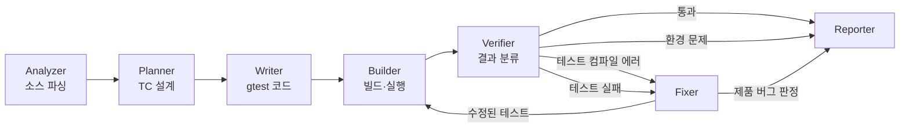
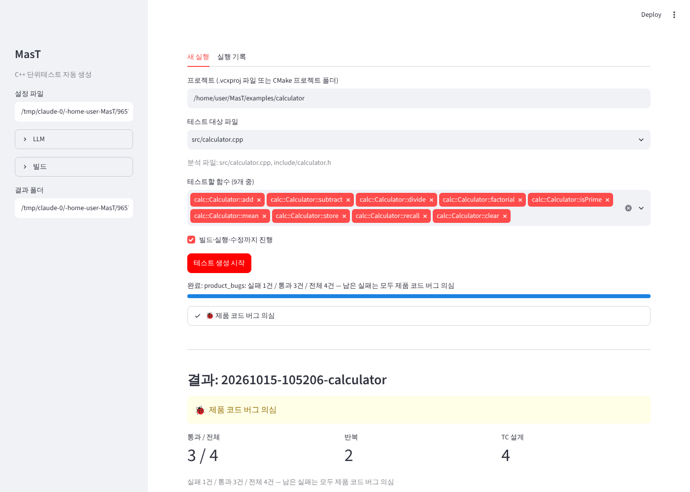
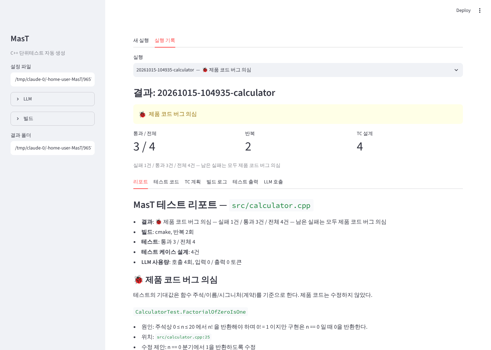
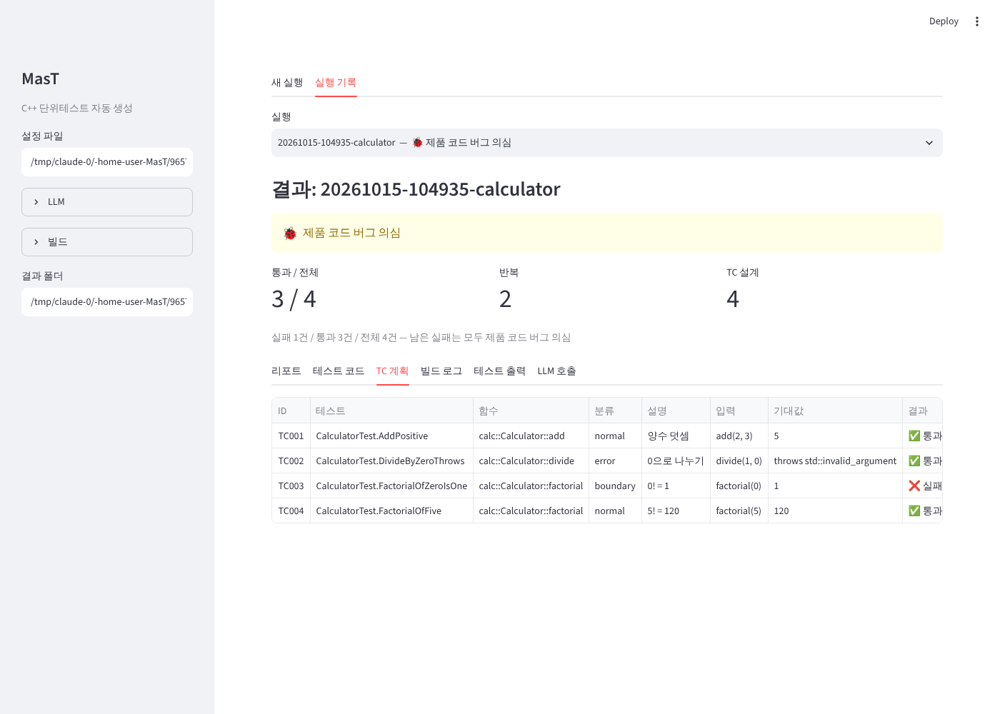

# MasT
## C++ 단위테스트 자동 생성 멀티 에이전트 시스템

**M**ulti-**a**gent **s**ystem for **T**est generation

- 대상: C++17 프로젝트 (Windows VS2019 / Linux CMake)
- 프레임워크: googletest (사내 nsfwtest 확장 예정)
- LLM: Claude API 또는 사내 LLM (OpenAI 호환)

<!-- 슬라이드는 `---`로 구분된다. Marp / Slidev 로 바로 변환 가능. 다이어그램은 Mermaid. -->

---

## 1. 문제

- 단위테스트 작성은 시간이 많이 들고 뒤로 밀린다
- LLM에 "테스트 짜줘"만 하면
  - 컴파일이 안 되는 코드가 자주 나온다
  - 구현을 그대로 베껴서 **버그를 정답으로 굳히는** 테스트가 나온다
  - 빌드 환경(include 경로, 정의, 라이브러리)을 모른다
- 결국 사람이 다시 고치고, 돌려보고, 판단해야 한다

**목표**: 생성에서 끝나지 않고 **빌드 → 실행 → 검증 → 수정**까지 자동으로 돌린다

---

## 2. 무엇을 하는가

```
입력: C++ 소스 파일 + 프로젝트(.vcxproj 또는 CMake)
                 │
                 ▼
출력: ① 컴파일되고 실행된 gtest 코드
      ② 테스트 케이스 표 (정상 / 경계 / 예외)
      ③ 실패 원인 판정 — 테스트 오류인가, 제품 버그인가
      ④ 제품 버그 의심 시 위치와 수정 제안 (제품 코드는 건드리지 않음)
      ⑤ 리포트 (report.md) + 웹 UI
```

---

## 3. 전체 구조



- LLM을 쓰는 에이전트: **Planner, Writer, Fixer** (3개)
- 결정적(코드로 처리): **Analyzer, Builder, Verifier, Reporter**
- 오케스트레이터: 단순 Python 상태 머신 (외부 에이전트 프레임워크 없음)

---

## 4. 에이전트별 역할

| 에이전트 | LLM | 입력 | 출력 |
|---|:-:|---|---|
| Analyzer | ✗ | .cpp / .h | 함수·클래스 목록, 시그니처, 주석, 선언+정의 병합 |
| Planner | ✓ | 함수 목록 + 소스 | TC 계획 (JSON): 입력, 기대값, 분류 |
| Writer | ✓ | TC 계획 + 헤더 | gtest 소스 파일 |
| Builder | ✗ | 테스트 + 제품 프로젝트 | 테스트용 프로젝트 생성, 빌드, 실행, XML 결과 |
| Verifier | ✗ | 빌드 로그 / 결과 | pass / 테스트 컴파일 에러 / 환경 문제 / 테스트 실패 |
| Fixer | ✓ | 에러 또는 실패 + 소스 | 수정된 테스트 / 실패별 판정 |
| Reporter | ✗ | 실행 결과 | report.md |

**원칙**: LLM은 판단이 필요한 곳에만. 파싱·빌드·분류는 코드로 해서 재현 가능하게.

---

## 5. 핵심 설계 ① 기대값은 "계약" 기준

- 기대값을 **구현이 아니라** 주석·함수 이름·시그니처에서 정한다
- 구현과 계약이 다르면 계약을 따르고 `notes`에 기록

```cpp
/// Returns n! for 0 <= n <= 20. Throws std::out_of_range otherwise.
static std::uint64_t factorial(int n);   // 구현은 factorial(0) == 0  (버그)
```

| TC | 입력 | 기대값 | 결과 | 판정 |
|---|---|---|---|---|
| TC003 | factorial(0) | 1 | ❌ 실패 | **제품 버그** |

→ 버그를 정답으로 굳히는 테스트를 막는다

---

## 6. 핵심 설계 ② 실패 원인 판정

테스트가 실패하면 Fixer가 실패마다 판정:

| 판정 | 의미 | 처리 |
|---|---|---|
| `test_bug` | 기대값 계산 실수, API 오용, 부동소수점 정확 비교 등 | 해당 테스트만 수정 후 재빌드 |
| `product_bug` | 테스트는 계약대로, 구현이 다름 | **제품 코드 수정 안 함**. 파일:라인 + 수정 제안 리포트 |
| `unclear` | 명세가 없어 양쪽 다 가능 | 사람에게 넘김 |

- 수정은 테스트 코드에만 자동 적용
- 같은 실패가 반복되면 중단, 최대 수정 횟수 설정 가능

---

## 7. 핵심 설계 ③ 기존 빌드 설정 재사용

**Windows (VS2019)**
- 제품 `.vcxproj`를 읽어 별도 `mast_tests.vcxproj` 생성 → msbuild
- 가져오는 것: include 경로, 전처리기 정의, 런타임 라이브러리, C++ 표준, 속성 시트(.props), 프로젝트 참조
- `$(ProjectDir)`, `$(SolutionDir)`, 사용자 정의 매크로 전개 / `Debug|x64` 조건 평가
- **원본 sln / vcxproj는 수정하지 않음**

**Linux (Rocky 10)**
- 테스트용 `CMakeLists.txt` 생성. 제품 소스 직접 컴파일 또는 제품 CMake 타깃에 링크

**공통**: googletest는 소스로 함께 컴파일 (별도 설치 불필요, 사내망용 로컬 경로 지원)

---

## 8. 핵심 설계 ④ 빌드 에러 분류

Verifier가 MSVC / GCC / CMake 로그를 파싱해 **에러 위치**로 분류

| 위치 | 예 | 다음 행동 |
|---|---|---|
| 테스트 코드 | `C2039 'addd' is not a member` | Fixer가 테스트 수정 |
| 제품 코드 / 링크 / 툴셋 | `C1083`, `LNK2019`, `MSB8020` | 멈추고 설정 힌트 제시 |

```
🛠️ 빌드 환경/설정 문제
- Platform Toolset을 찾을 수 없음 → build.toolset 을 v142/v143으로 지정
- 헤더를 찾을 수 없음 → build.include_dirs 에 경로 추가
```

→ LLM이 고칠 수 없는 문제에 토큰을 쓰지 않는다

---

## 9. 실행 예시 (샘플 프로젝트)

`examples/calculator` — 의도적 버그 1개 포함

```
[analyze] 9 testable functions
[plan]    TC 설계
[write]   tests/calculator_test.cpp
[build] [0] 빌드 → 테스트 코드 컴파일 에러 1건 (addd)
[fix]   [0] 컴파일 에러 수정
[build] [1] 빌드 → 실행
[verify][1] 실패 1건 / 통과 3건 / 전체 4건
[fix]   [1] 실패 판정 → FactorialOfZeroIsOne: product_bug

결과: 🐞 제품 코드 버그 의심 — 위치 src/calculator.cpp:25, 수정 제안: n == 0 일 때 1 반환
```

※ 위 흐름은 자동 테스트에서 LLM 응답을 고정한 시나리오로 검증한 것

---

## 10. 결과물

실행마다 `runs/<시각>-<파일명>/`

| 파일 | 내용 |
|---|---|
| `report.md` | 결과 요약, 제품 버그 수정 제안, TC 표, 진행 이력 |
| `tests/*_test.cpp` | 최종 테스트 코드 |
| `history/` | 수정 단계별 테스트 코드 버전 |
| `plan.json` | TC 계획 |
| `build/` | 생성된 테스트 프로젝트 (vcxproj / CMakeLists) |
| `build.log`, `test_output.log` | 빌드·실행 로그 |
| `llm_calls.jsonl` | 모든 LLM 요청/응답 (디버깅, 프롬프트 튜닝용) |
| `usage.json` | 토큰 사용량 |

---

## 11. 웹 UI — 실행



프로젝트 → 대상 파일 → 함수 선택 → 시작. 단계별 진행 표시

---

## 12. 웹 UI — 결과



---

## 13. 웹 UI — TC 표



탭: 리포트 / 테스트 코드(다운로드, 수정 이력) / TC 계획 / 빌드 로그 / 테스트 출력 / LLM 호출

---

## 14. 사용법

```powershell
# 설치 (Windows)
powershell -ExecutionPolicy Bypass -File scripts\setup.ps1
$env:ANTHROPIC_API_KEY = "sk-..."

mast check-llm                       # LLM 연결 확인
mast selftest                        # 툴체인 확인 (LLM 없이 샘플 빌드)
mast analyze  src\foo.cpp            # 테스트 대상 함수 목록
mast generate src\foo.cpp -p foo.vcxproj   # 생성 → 빌드 → 검증 → 수정
mast report   runs\<run>             # 리포트 재생성
mast ui                              # 웹 UI
```

---

## 15. LLM 교체 / 설정

```yaml
llm:
  provider: openai_compat          # anthropic | openai_compat
  model: corp-llm-70b
  base_url: https://llm.corp.example/v1
  api_key_env: CORP_LLM_API_KEY    # 키는 환경변수로만
  ca_bundle: C:\certs\corp-ca.pem  # 사내 인증서

agents:                            # 에이전트별 모델 지정 가능
  fixer:
    provider: anthropic
    model: claude-opus-5-5
```

- 프롬프트는 `mast/prompts/*.md` — 코드 수정 없이 튜닝
- 테스트 프레임워크는 어댑터 구조 (`TestFramework`) — nsfwtest 추가 지점

---

## 16. 기술 스택

| 영역 | 사용 |
|---|---|
| 언어 | Python 3.11+ |
| C++ 파싱 | tree-sitter-cpp |
| LLM | anthropic SDK, openai SDK (OpenAI 호환) |
| 데이터 검증 | pydantic (LLM 응답 JSON 스키마 검증 + 재요청) |
| 빌드 | msbuild (vswhere 자동 탐색), CMake |
| 테스트 | googletest 1.17.0 |
| CLI / UI | typer, Streamlit |

---

## 17. 신뢰성 장치

- LLM 응답 형식 오류 → 에러 내용을 돌려주고 재요청
- 빌드·실행 타임아웃, 크래시 시 콘솔 출력에서 결과 복구
- Windows 크래시/assert 대화상자 차단 (자체 test main) → 무인 실행 가능
- 한글 Windows 대응: 테스트 파일 UTF-8 BOM 저장, 빌드 로그 cp949 디코딩, 영문 진단 출력(`VSLANG=1033`)
- 같은 실패 반복 감지 → 무한 루프 방지
- 모든 LLM 호출 기록 → 결과 추적 가능

---

## 18. 검증 현황

| 항목 | 상태 |
|---|---|
| 자동 테스트 | 50개 통과 (Linux) |
| Linux CMake 빌드·실행·수정 루프 | ✅ 실제 빌드로 검증 |
| 웹 UI 전체 흐름 | ✅ 브라우저 자동화로 검증 (가짜 LLM 서버) |
| vcxproj 파싱·생성 | ✅ 단위 테스트 (XML 구조) |
| **Windows msbuild 실제 빌드** | ⏳ 로컬 PC 검증 필요 |
| **실제 LLM 품질 (TC 설계, 판정 정확도)** | ⏳ 실데이터 평가 필요 |

---

## 19. 한계

- 의존성이 많은 코드(DB, 네트워크, 하드웨어)는 링크/실행이 어렵다 → 현재는 설정으로 소스·라이브러리 보충
- 복잡한 `.props` 상속·커스텀 매크로는 자동으로 다 못 읽을 수 있다
- 판정 정확도는 LLM 품질과 주석(계약) 품질에 좌우된다
- private 함수, 템플릿 인스턴스화가 필요한 코드는 범위 밖

---

## 20. 로드맵

| 단계 | 내용 |
|---|---|
| 2단계 | gmock 기반 의존성 모킹 |
| 2단계 | 커버리지 측정 (OpenCppCoverage / gcov) → 미커버 분기 기반 TC 보강 |
| 2단계 | 사내 nsfwtest 프레임워크 어댑터 |
| 3단계 | 여러 파일 병렬 처리, CI 연동 |
| 3단계 | 판정 정확도 평가 세트 구축 → 프롬프트 개선 |

---

## 21. 요약

- **생성에서 끝나지 않는다**: 빌드 → 실행 → 검증 → 수정까지 자동
- **버그를 굳히지 않는다**: 계약 기준 기대값, 테스트 오류와 제품 버그를 구분
- **기존 환경 그대로**: VS2019 프로젝트 설정 재사용, 원본 무수정
- **교체 가능**: Claude / 사내 LLM, gtest / nsfwtest
- **추적 가능**: 모든 LLM 호출, 수정 이력, 리포트 저장

### Q&A
